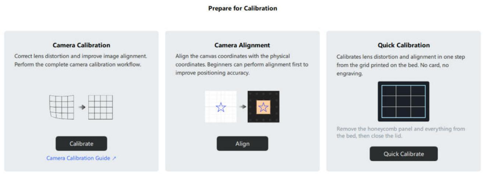
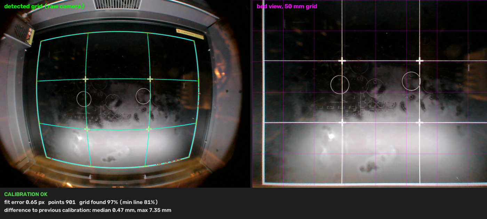
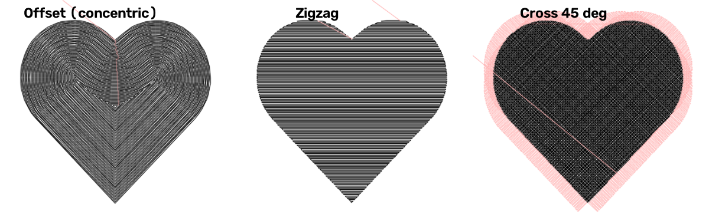
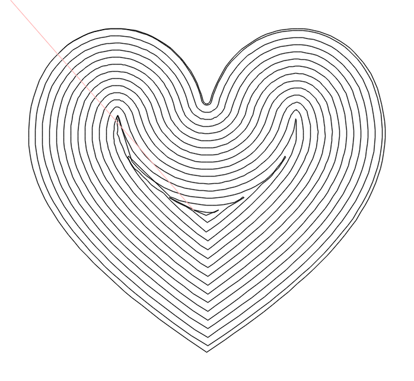

# FalconMods

Unofficial improvements for **Creality Falcon Design Space** and the **Creality Falcon A1** laser engraver.

* **Quick Calibration:** one-click camera calibration (lens distortion *and* camera-to-laser
  alignment) from the grid that's already printed on the A1 bed plate. No dot card, no ArUco board,
  no test engraving, no clicking markers. It runs in a page inside the app, and the app restarts by
  itself to load the result.
* **Automatic laser alignment:** the stock *Camera Alignment* step gets a **Detect markers** button
  that finds the four engraved crosshairs (≈0.1 mm), so there's no double-clicking. It applies live, without a
  restart, and later Quick Calibrations keep that laser registration. Measured on a real A1: the
  camera view matches the burned markers within about 0.1–0.2 mm.
* **Concentric (Offset) fill and friends:** unlocks *Offset Fill* (concentric), *Cross Fill*,
  *Zigzag Fill* and the *Fill angle* for gantry lasers. The engine already implements them, but the UI
  only showed them for galvo machines.
* **Spiral fill:** a *Spiral* tool that turns a closed shape into **one continuous spiral line**
  instead of separate concentric rings, so the laser doesn't stop and restart for every ring.

> **Not affiliated with Creality.** This repo contains **no Creality code or assets**. The
> installer modifies the copy of Falcon Design Space that is already installed on your PC, keeps the
> original files, and restores them on uninstall. Modifying the app may conflict with Creality's
> license terms. Use at your own risk.

| | |
|---|---|
|  |  |
|  |  |

## Download & use

Grab `FalconMods-Setup-x.y.z.exe` from Releases, close Falcon Design Space and run it.
See the **[user guide](docs/USER_GUIDE.md)**.

Tested with Falcon Design Space **1.10.7** on Windows 11 and a Falcon A1 (10 W).

## How it works

### Falcon Design Space internals

Falcon Design Space is a Qt 6 / C++ application. Its entire UI is QML shipped as plain text in Qt
resource bundles (`mui/qml.rcc`, `mui/qml_new.rcc`). `tools/rcc.py` reads and writes that format
(v3, zlib). `tools/patcher.py` applies small anchored text patches (`patches/*.py`) to the user's
installed bundles. If an anchor isn't found exactly as expected (different app version), nothing is
written.

### Fill patterns

`ClLayer.FillPattern` = `OneWay, Bidirectional, Cross, Offset, ZigZag`. The G-code generator
handles all of them on gantry machines (verified by exporting and rendering G-code with
`tools/gcode_preview.py`). The patch is a single QML condition in `LayerEditorPopup.qml`.

### Spiral fill (`patches/spiral_fill.py`)

The engine has no spiral mode, so FalconMods generates the toolpath itself
(`patches/qml/FalconModsSpiral.js`):

1. **Distance field.** A grid of exact distances to the outline. A Felzenszwalb EDT over the cells
   next to the outline finds each node's nearest segment, refined by walking along the outline,
   then the exact point–segment distance is taken.
2. **Rings.** Marching squares at the levels *interval/2 + k·interval* give consistently oriented
   rings; ring vertices are polished onto the exact level with Newton steps. Each ring is linked
   to the ring one level further out, which gives a tree.
3. **Spiral.** Along each unbranched chain of rings, every vertex of ring *N* at arc-length
   fraction *t* is projected onto level *level(N) + t·interval*. One turn morphs ring *N* into
   ring *N+1*, so the chain becomes one polyline: a full loop on the outline, one turn per ring,
   a final turn into the centre. Where the rings split, each branch starts its own spiral.

In the app, the *Spiral* button exports the canvas with `clApplication.saveSvg`, runs the
generator in a hidden `WebEngineView` (Chromium reads the local export and runs the code about
100× faster than QML's JS engine), imports the result with `webCommon.saveSvg`, moves it onto the
original and sets it to Line Engraving. The patcher embeds the scripts as a string
(`FalconModsSpiralSource.js`) because the page can't load `qrc:` resources. Tests run the
generator under Node (`tests/js/spiral_cli.js`).

### Bed-grid calibration (`calib/falcon_bedgrid`)

Falcon Design Space stores the calibration in `%LOCALAPPDATA%\Falcon Design Space\conf\camera\cameraConfig.txt`:
`IntrinsicMat` K, `DistCoeffs` D (OpenCV k1 k2 p1 p2 k3), `NewCameraMatrix` K′ and a 3×3
`WorldMatrix` W. The canvas background is

```
view = flipV( warpPerspective( undistort(raw, K, D, K′), W, (381·6, 305·6) ) )      # 6 px/mm
```

with the processing height *t* applied as `f(K′) · (180 − t)/(180 − Thickness)`.
These were found by fitting the app's own output images; see `docs/RESEARCH.md`.

The A1 bed plate has a printed grid: an outer frame, two vertical and two horizontal lines (~126 × 100 mm
cells) and four "+" marks. From a single photo (2592×1944, strong wide-angle distortion) the tool:

1. Predicts every grid line from a prior camera model (your existing calibration, or a default),
   after a brute-force image-shift search.
2. Samples each line every 2.5 mm and searches along the image normal for the thin bright ridge
   (top-hat filtered, sub-pixel peak). This ignores stains, engravings, cards and the warning sticker.
3. Fits pose, principal point and distortion with a robust Levenberg–Marquardt solver (soft-L1,
   NumPy only), minimizing the perpendicular distance of every ridge sample to its projected line.
   Lens model: OpenCV radial/tangential + thin-prism terms (12 stored coefficients). Falcon Design
   Space passes all of them to `cv::undistort`.
   Straightness of the lines constrains distortion. The known line positions fix the
   mapping into laser coordinates. The outer-frame positions are estimated too.
4. Coarse-to-fine: inner lines first, a 1-D scan to place the frame, then everything, with outlier
   rejection.
5. Writes K, D, K′ and W in the app's convention (backup first). Because the app writes its
   in-memory calibration back on exit, *Apply* closes the app politely, writes, and relaunches it.

The UI is a QML page inside the app (stock components). It drives the helper through a
`falconbedgrid://` URL and a small file-based job protocol; see [docs/ARCHITECTURE.md](docs/ARCHITECTURE.md).

**Laser registration.** Where the printed grid sits relative to the laser varies a little between
machines. Whenever the app's current calibration wasn't written by FalconMods (factory calibration,
or a stock *Camera Alignment*), the helper measures the grid lines *through* that calibration and
remembers their laser positions for this machine. The stock alignment pattern
(`gcode.genCalibationPathGcodes`: Ø20 mm crosshairs at (100.5, 242.5), (280.5, 242.5),
(280.5, 62.5), (100.5, 62.5) mm) is found automatically by `markers.py`: a ring + cross matched
filter, then straight-line fits to the cross arms. It's handed to the app's own
`genWorldMatirx`, which maps exactly these four points (verified), so no restart is needed.

Typical result on a real A1: **~0.4 px RMS** over ~900 grid samples. In the app's own camera view the
inner grid lines bend by at most ~0.2 mm and sit within ~0.3 mm of their laser positions. The outer
frame stays within ~±0.4 mm, about one camera pixel at the edges, where colour fringing and
bed-plate flatness limit any camera calibration (`tools/straightness.py` measures this).

Focal length and camera height can't be separated from one view of a plane (any f fits equally).
The app uses a fixed 180 mm camera height for thickness compensation, so the tool keeps the prior
focal length.

## Repository layout

```
calib/falcon_bedgrid/   calibration helper: engine, marker detection, job protocol, CLI/Tk (Python, OpenCV, NumPy)
  templates/            bed-grid geometry per machine (JSON)
patches/                QML patch definitions (+ new QML/JS files in patches/qml)
tools/                  rcc.py, patcher.py, build/publish scripts, gcode_preview.py, straightness.py, devrun.sh
installer/              Inno Setup script, icon
tests/                  pytest suite (synthetic data + one real alignment photo, no vendor files; spiral tests need Node.js)
docs/                   ARCHITECTURE, RESEARCH, USER_GUIDE, PLAN, PROGRESS
CLAUDE.md               start here if you want to modify FalconMods (for humans and AI agents)
```

## Building

Requirements: Windows, Python 3.12, [Inno Setup 6](https://jrsoftware.org/isinfo.php),
Node.js (for the spiral tests).

```bash
python -m venv .venv
.venv/Scripts/python -m pip install -r requirements-dev.txt
.venv/Scripts/python tools/build_release.py      # tests, exes, installer -> dist/
```

Developer commands:

```bash
.venv/Scripts/python -m pytest tests
.venv/Scripts/python tools/patcher.py check                      # do the patches fit the installed app?
.venv/Scripts/python tools/patcher.py install --app "<copy of the app folder>" --dev
cd calib && ../.venv/Scripts/python -m falcon_bedgrid --cli --image photo.jpg --out out/
.venv/Scripts/python tools/publish_release.py                    # push, tag and publish the release
```

Want to change or extend something? Read [CLAUDE.md](CLAUDE.md) (workflow, safety rules for the
user's calibration file, dev hook) and [docs/ARCHITECTURE.md](docs/ARCHITECTURE.md).

## Security and privacy

- Everything runs locally. FalconMods never connects to the internet and collects nothing.
- The installer needs admin rights once, to patch the app in `Program Files`. It keeps the
  original files and restores them on uninstall.
- The helper is started through a `falconbedgrid://` link. Its parameters are strictly
  validated. Apart from its own folder (`%LOCALAPPDATA%\Falcon Design Space\falconmods`), the only
  file it changes is the app's camera calibration (with a backup first), so a forged link can at
  worst restart Falcon Design Space. Details: *Security* in [docs/ARCHITECTURE.md](docs/ARCHITECTURE.md).

## Adding another machine

Create `calib/falcon_bedgrid/templates/<machine>.json` with the grid line positions in laser
coordinates (measure them against a known-good calibration), and relax the device check in
`patches/qml/FalconModsBedGridCard.qml`.

## License

MIT, see [LICENSE](LICENSE).
